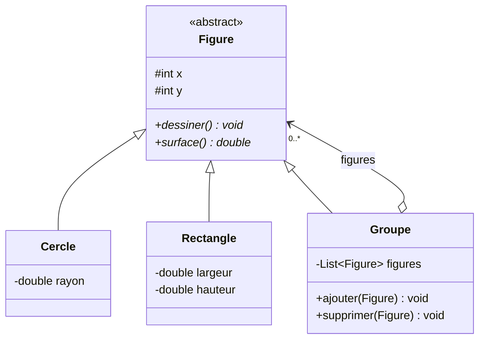
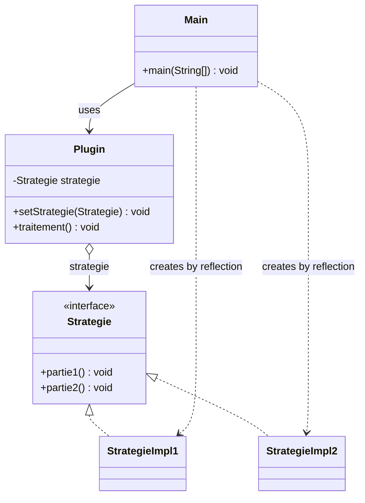
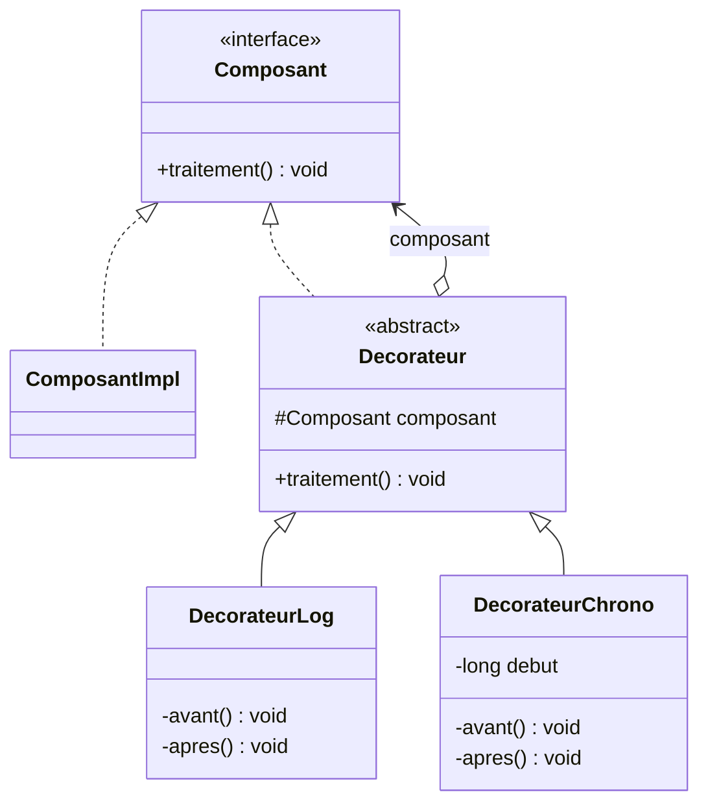
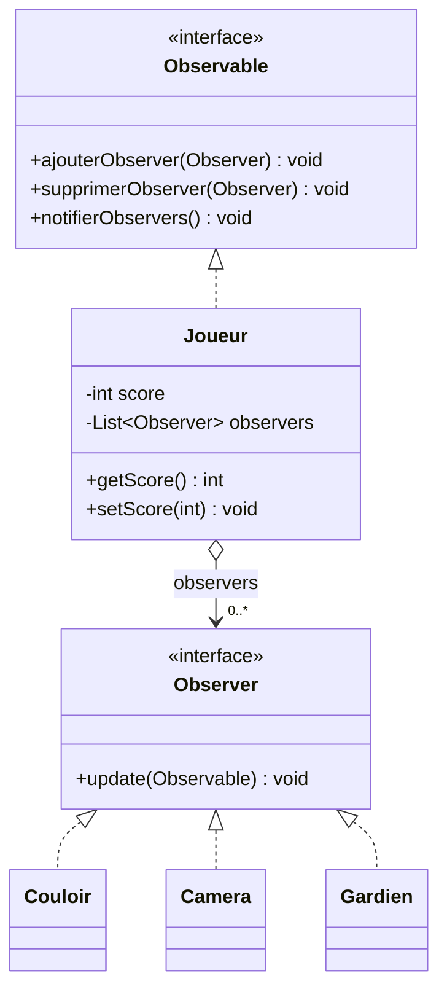
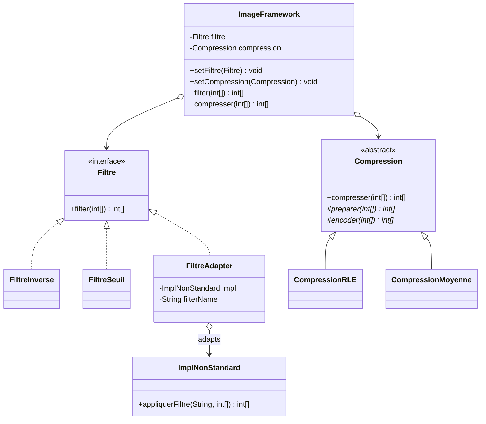

# TP4 — Design Patterns

Java solutions for the TD *Design Patterns* (ENSET Mohammedia, GLSID).

- **Exercise 1**: four situations, each solved with one design pattern.
- **Exercise 2**: an image processing framework that combines **Strategy**, **Adapter** and **Template Method**.

Each situation is in its own package and has its own `Main`, so every part can be run on its own.

## Patterns at a glance

| Exercise | Situation | Pattern | Package |
|---|---|---|---|
| 1 | A figure is a circle, a rectangle or a group of figures | Composite | `ex1.composite` |
| 1 | A plugin with a fixed algorithm and two variable parts | Strategy | `ex1.strategy` |
| 1 | Add actions before and after `traitement()` without changing the component | Decorator | `ex1.decorator` |
| 1 | Game objects informed when the player's score changes | Observer | `ex1.observer` |
| 2 | Filters that can be added and swapped at runtime | Strategy | `ex2.framework`, `ex2.extensions` |
| 2 | Reuse `ImplNonStandard`, which has a different signature | Adapter | `ex2.adapter`, `ex2.ancien` |
| 2 | Compression skeleton, details in subclasses | Template Method | `ex2.framework`, `ex2.extensions` |

## Project structure

```
tp4-design-patterns/
├── pom.xml
└── src/main/java/
    ├── ex1/
    │   ├── composite/    Figure, Cercle, Rectangle, Groupe, Main
    │   ├── strategy/     Strategie, StrategieImpl1, StrategieImpl2, Plugin, Main
    │   ├── decorator/    Composant, ComposantImpl, Decorateur,
    │   │                 DecorateurLog, DecorateurChrono, Main
    │   └── observer/     Observable, Observer, Joueur,
    │                     Couloir, Camera, Gardien, Main
    └── ex2/
        ├── framework/    Filtre, Compression, ImageFramework
        ├── extensions/   FiltreInverse, FiltreSeuil,
        │                 CompressionRLE, CompressionMoyenne
        ├── ancien/       ImplNonStandard
        ├── adapter/      FiltreAdapter
        └── Main.java
```

## Run it

Requires **Java 21** and **Maven**.

```bash
mvn compile
java -cp target/classes ex1.composite.Main
java -cp target/classes ex1.strategy.Main
java -cp target/classes ex1.decorator.Main
java -cp target/classes ex1.observer.Main
java -cp target/classes ex2.Main
```

In IntelliJ: right-click any `Main.java` → **Run 'Main.main()'**.

---

## Exercise 1

### Situation 1 — Composite

> *Une figure peut être soit un cercle, un rectangle ou un groupe de figures.*

A `Groupe` **is** a `Figure` and **contains** figures, so groups can be nested in a tree. The client calls `dessiner()` or `surface()` the same way on a single shape or on a whole group.




```
Groupe (0, 0) debut
Cercle (0, 0) rayon = 1.0
Rectangle (5, 5) 2.0 x 3.0
Groupe (10, 10) debut
Cercle (10, 10) rayon = 2.0
Rectangle (12, 12) 1.0 x 1.0
Groupe (10, 10) fin
Groupe (0, 0) fin
Surface totale : 22.71
Surface sans le rectangle : 16.71
```

### Situation 2 — Strategy

> *Un plugin contient une opération implémentant le squelette d'un algorithme dont deux parties (partie1 et partie2) sont variables […] l'application cliente puisse instancier une implémentation concrète du plugin sans connaître sa classe d'implémentation.*

`Plugin` keeps the fixed steps and delegates `partie1()` and `partie2()` to a `Strategie`. `Main` never writes `new StrategieImpl1()`: it creates the strategy from its class name with reflection.



```java
Strategie s = (Strategie) Class.forName("ex1.strategy.StrategieImpl" + n)
        .getConstructor()
        .newInstance();
plugin.setStrategie(s);
plugin.traitement();
```

```
Etape fixe : ouvrir le plugin
  [Impl1] partie1 : formater les donnees en CSV
Etape fixe : verifier le resultat
  [Impl1] partie2 : enregistrer dans un fichier
Etape fixe : fermer le plugin
```


### Situation 3 — Decorator

> *On voudrait rattacher à ce composant des responsabilités supplémentaires sans modifier son code source […] envelopper l'exécution de la méthode traitement par d'autres traitements avant et après son exécution.*

Each decorator **is** a `Composant` and **holds** a `Composant`. It runs its "before" step, calls the wrapped component, then runs its "after" step. Decorators can be stacked in any order.



```java
Composant c = new DecorateurLog(new DecorateurChrono(new ComposantImpl()));
c.traitement();
```

```
[LOG] Debut du traitement
  [CHRONO] Demarrage
    >> Traitement du composant (calcul...)
  [CHRONO] Duree : 100 ms
[LOG] Fin du traitement
```


### Situation 4 — Observer

> *On voudrait que les objets de l'environnement du jeu (Couloir, Caméra et Gardien) soient informés à chaque fois que le score du joueur change tout en gardant un couplage faible.*

`Joueur` only knows the `Observer` interface. `setScore()` saves the score, then notifies every subscriber. Each observer pulls the new score with `getScore()`.



```
===== Score = 120 =====
[Couloir] Score 120 : la porte secrete s'ouvre
[Camera]  Zoom sur le joueur, nouveau score : 120
[Gardien] Alerte ! Le joueur est trop fort, je l'attaque

===== Gardien desabonne, score = 150 =====
[Couloir] Score 150 : la porte secrete s'ouvre
[Camera]  Zoom sur le joueur, nouveau score : 150
```


---

## Exercise 2 — Image processing framework

An image is an `int[]`: each cell is a pixel from **0 (black)** to **255 (white)**. The framework offers two operations, `filter(int[])` and `compresser(int[])`.

| Criterion | Solution |
|---|---|
| Closed to modification, open to extension | `ImageFramework` only depends on `Filtre` and `Compression` |
| Users can add new filters | **Strategy**: implement `Filtre` |
| Change the filter at runtime | `setFiltre()` |
| Reuse `ImplNonStandard.appliquerFiltre(String, int[])` | **Adapter**: `FiltreAdapter` |
| Compression skeleton, details in subclasses | **Template Method**: `final compresser()` calls `preparer()` then `encoder()` |
| User types the class names (Q3) | Reflection in `ex2.Main` |



### Implementations

| Class | What it does | Example on `[10, 10, 10, 200, 200, 90, 90, 90, 255, 0]` |
|---|---|---|
| `FiltreInverse` | Negative: `255 - v` | `[245, 245, 245, 55, 55, 165, 165, 165, 0, 255]` |
| `FiltreSeuil` | Black and white: `v >= 128 ? 255 : 0` | `[0, 0, 0, 255, 255, 0, 0, 0, 255, 0]` |
| `FiltreAdapter` | Calls `ImplNonStandard` with `"eclaircir"` (+50) | `[60, 60, 60, 250, 250, 140, 140, 140, 255, 50]` |
| `CompressionRLE` | Each run of identical pixels → (value, count) | `[10, 3, 200, 2, 90, 3, 255, 1, 0, 1]` |
| `CompressionMoyenne` | Each pair of pixels → their average | `[10, 105, 145, 90, 127]` |

### Using the application

Type the **full class name**, including the package:

| Type | Class name |
|---|---|
| Filter | `ex2.extensions.FiltreInverse` |
| Filter | `ex2.extensions.FiltreSeuil` |
| Filter (legacy class) | `ex2.adapter.FiltreAdapter` |
| Compression | `ex2.extensions.CompressionRLE` |
| Compression | `ex2.extensions.CompressionMoyenne` |


```
Votre choix : 1
Classe du filtre : ex2.extensions.FiltreSeuil
Filtre change.

Votre choix : 3
Image filtree : [0, 0, 0, 255, 255, 0, 0, 0, 255, 0]

Votre choix : 2
Classe de compression : ex2.extensions.CompressionRLE
Compression changee.

Votre choix : 4
Image compressee : [0, 3, 255, 2, 0, 3, 255, 1, 0, 1]

Votre choix : 1
Classe du filtre : FiltreSeuil
Erreur : java.lang.ClassNotFoundException: FiltreSeuil
```

### Adding a new filter

1. Create `ex2/extensions/FiltreFlou.java` that implements `Filtre`.
2. Run `ex2.Main` and type `ex2.extensions.FiltreFlou`.

No other file changes, not even `Main`.